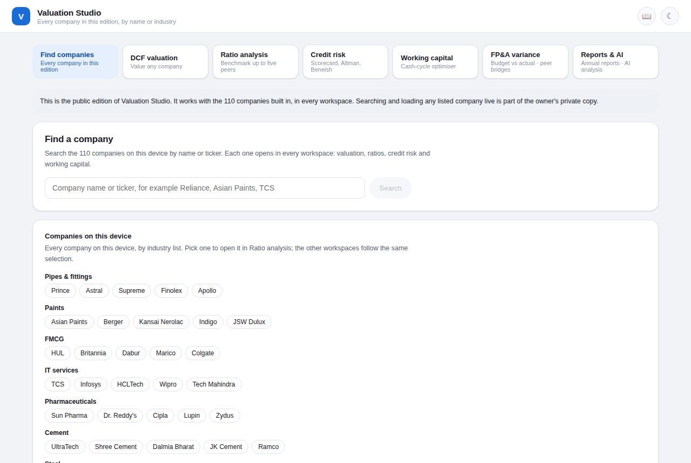
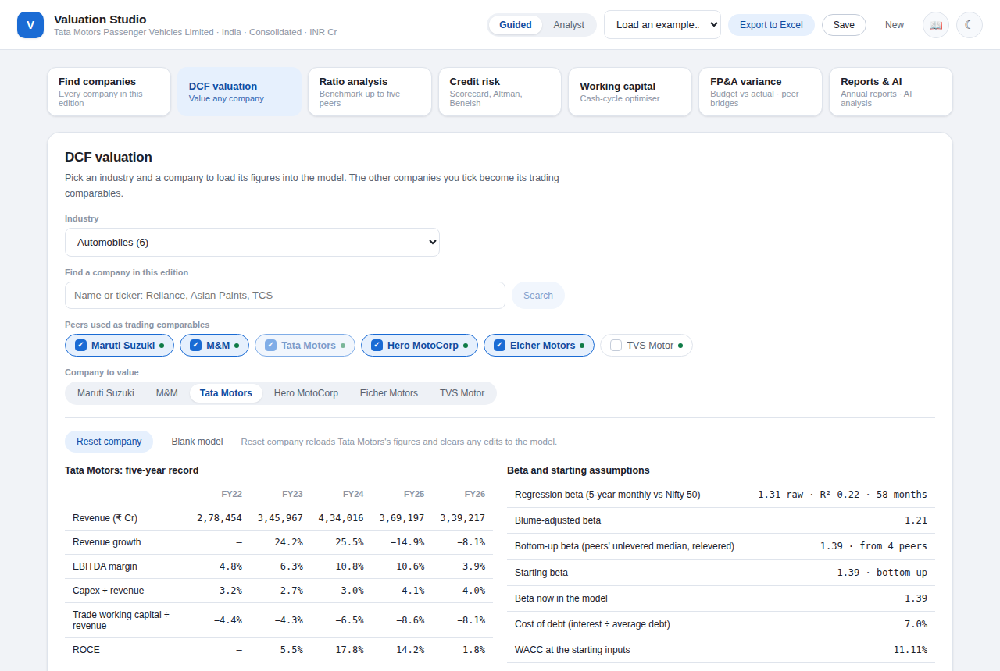
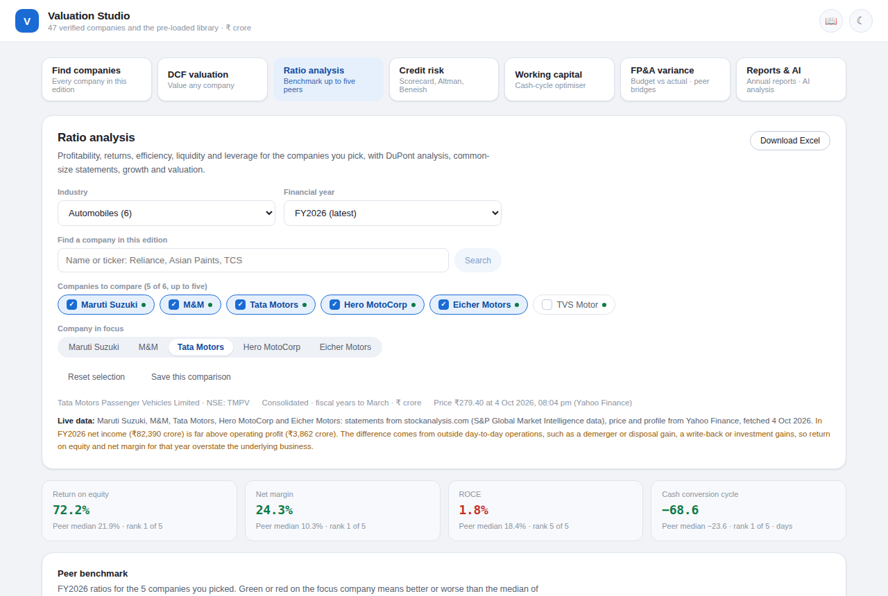

# Valuation Studio

A browser-based financial analysis toolkit. It values a company with a discounted cash flow model, benchmarks it against peers, scores its credit risk, sizes the cash tied up in working capital and explains budget variances, all from the same set of financial statements.

**Open it:** https://007reborn.github.io/valuation-studio/

It runs in any browser, on a phone or a laptop, with nothing to install and no sign-in.



## What it does

| Workspace | What you can do |
| --- | --- |
| **Find companies** | Search 110 companies by name, ticker or industry and open any of them in every other workspace. |
| **DCF valuation** | Ten-year, two-stage free cash flow forecast. Cost of capital from CAPM with a regression beta or a bottom-up beta from the peers you pick. Terminal value by perpetual growth and by exit multiple, trading comparables, sensitivity tables, scenarios, a Monte Carlo simulation, a linked three-statement model and an Excel export. Country defaults for more than 40 markets. |
| **Ratio analysis** | Profitability, returns, efficiency, liquidity and leverage for up to five peers, with three-step and five-step DuPont analysis, common-size statements and five-year trends. |
| **Credit risk** | A weighted scorecard, Altman Z-score, Piotroski F-score, Beneish M-score, Zmijewski score and a synthetic rating from interest coverage, with stress scenarios. |
| **Working capital** | Receivable, inventory and payable days against peers, the cash conversion cycle, and the cash released by moving to a chosen target. |
| **FP&A variance** | Budget against actual, with revenue variance split into price, mix and volume and an EBITDA bridge that adds up exactly. |
| **Reports & AI** | Read an annual report or filing you upload. Inside Claude, an AI analyst can also summarise it and answer questions. |





## The companies

- **47 verified companies** listed on the NSE, in ten industries (pipes, paints, FMCG, IT services, pharmaceuticals, cement, steel, cables, tyres and city gas), with consolidated statements for FY2022 to FY2026.
- **63 pre-loaded companies** in thirteen ready-made peer groups: Indian large caps (oil and gas, automobiles, power, engineering, consumer, metals, telecom, internet platforms, hospitals), US technology and consumer names, and global leaders such as Toyota, Samsung, TSMC, Nestlé, Shell, LVMH and SAP. Statements reported in dollars, yen, won, euros and other currencies are translated into rupees.
- **7 banks and insurers** as profiles only. Their accounts follow a different format, so the industrial-company tools are deliberately not applied to them.

Every pre-loaded company carries its own data checks: the statements must add up (gross profit, EBITDA, the balance sheet identity, free cash flow), and six headline figures are compared with a second source. Where a figure needs care, the page says so in plain words, for example when a demerger breaks a revenue series or a one-off gain inflates a year's net income.

## Where the figures come from

- Financial statements: standardised statements published on stockanalysis.com (S&P Global Market Intelligence data).
- Prices, company profiles, five-year monthly price histories for beta, and the cross-check figures: Yahoo Finance.
- The pre-loaded companies were fetched on 4 October 2026.

These are third-party figures and may contain errors. Valuation Studio is a learning and analysis tool. Nothing in it is investment advice.

## Two editions

This repository builds two pages from the same source:

- **Public edition** (the page linked above, `docs/index.html`). It works entirely from the companies built into it.
- **Private edition**. It adds a live data layer: search any listed company, fetch five years of statements, today's price and a regression beta, and keep loaded companies in step across devices. It runs inside Claude and reaches data through MCP servers (Yahoo Finance, Tavily, SEC EDGAR) or, away from the home computer, through a Firecrawl connector, with pacing, failover between the two routes and a running count of credits used.

## How it is built

- One self-contained HTML page per edition. React 18 is loaded from a CDN; there is no server and no bundler.
- `build.js` compiles the JSX with Babel, patches the DCF application shell (`pub_current.html`) and writes the finished page.
- Excel exports are built in the browser with `xlsx-js-style` and keep live formulas, so the workbook recalculates.

```
npm install
node build.js --public     # writes valuation_studio_public.html (copy it to docs/index.html)
node build.js              # writes valuation_studio.html, the private edition
```

### Files

| Path | What it is |
| --- | --- |
| `pub_current.html` | The DCF application shell that the build extends |
| `suite_engine.js` | Ratio, credit, working-capital and valuation calculations |
| `suite_live_engine.js`, `suite_sync.js` | Live data layer: routes, parsers, checks, the pre-loaded library, cross-device storage |
| `suite_*.jsx` | The workspaces |
| `suite_src2.json` | The 47 verified companies |
| `harvest/library.json` | The pre-loaded companies and profiles |
| `harvest/` | Tools that rebuild the library from captured data-provider responses |
| `test_*.js`, `render_check*.js` | Automated checks |
| `docs/` | The published public edition and screenshots |

## Testing

- `node test_engine2.js` checks the calculation engine against `ref2.json`, an independent recomputation in Python (`ref2.py`): 9,395 values, no mismatches.
- `test_cloud.js` and `test_sync.js` exercise the live data layer and the cross-device storage (157 checks).
- `test_live_e2e.js` and `test_away_e2e.js` drive the built pages in a real browser with Playwright, at desktop and phone sizes (177 checks).
- `render_check2.js` and `render_check_lib.js` open every workspace for every company group in light and dark themes and look for errors, broken numbers and sideways scrolling.

The live-layer and browser suites replay captured responses from the data providers. Those captures are third-party content and are not published here, so only `test_engine2.js` runs from a fresh clone.

## About

Designed and directed by [Vighnesh Shinde](https://www.linkedin.com/in/vighnesh-k-shinde-a04991286/) and built through AI-assisted development with Claude.
